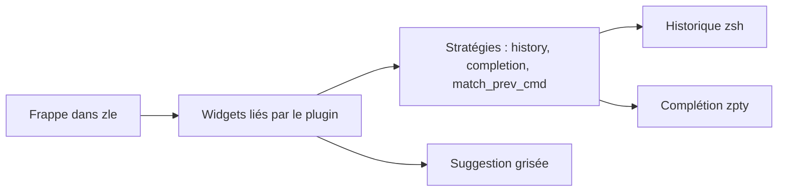

# zsh-users/zsh-autosuggestions

> Extension zsh qui propose des commandes en grisé pendant la frappe, d'après l'historique et la complétion.

## Le problème
Retaper des commandes longues déjà utilisées fait perdre du temps dans le terminal.

## Ce que ça fait vraiment
Affiche après le curseur une suggestion tirée de l'historique, de la complétion ou de la commande précédente (stratégies history, completion, match_prev_cmd). La flèche droite ou Fin l'accepte, forward-word l'accepte en partie. Les suggestions sont récupérées en asynchrone depuis zsh 5.0.8. Réglages par variables `ZSH_AUTOSUGGEST_*`.

## Comment c'est branché

Schéma simplifié d'après la fiche, sans diagramme fourni.

## Essayer
```bash
ZSH_AUTOSUGGEST_STRATEGY=(history completion)
ZSH_AUTOSUGGEST_BUFFER_MAX_SIZE=20
bindkey '^ ' autosuggest-accept
```

## Coût et pièges
Gratuit. Exige zsh 4.3.11 ou plus. Le dernier push date de juin 2025. Des conflits avec d'autres plugins sont possibles, d'où la consigne de réduire sa config avant de signaler un bogue.

## Ce que ce n'est pas
Pas de l'IA : pas de modèle, seulement l'historique et la complétion. Pas un remplacement de shell. Les étapes d'installation sont dans INSTALL.md, absent du README fourni.

## Alternatives
Aucune alternative nommée dans le README.

## Pour toi
À adopter : tu passes ta journée dans le terminal, le gain est immédiat et le coût nul, malgré un dépôt peu actif depuis un an.

