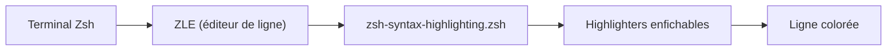

# zsh-users/zsh-syntax-highlighting

> Live Fish-style syntax highlighting for the Zsh command line.

## The problem
Syntax errors in a command only show up after running it.

## What it actually does
Colors the command as you type in an interactive Zsh terminal, which helps proofread it before execution. Hooks into the ZLE line editor. The rules are carried by pluggable, configurable "highlighters".

## How it is wired

Simplified diagram based on the sheet, no diagram supplied.

## Trying it
Installation commands are not in this README: it points to INSTALL.md. The only instruction given: source `zsh-syntax-highlighting.zsh` at the end of `.zshrc`.

## Cost and gotchas
Free, BSD-3-Clause license. Requires Zsh 4.3.11 or later; highlighting during incremental history search requires Zsh 5.4. It must be loaded last in `.zshrc`, after other widgets and hooks.

## What it is not
Not an autocompletion or a prompt theme: it only colors. No release announcement channel (releases RSS feed only).

## Alternatives
- Fish: the shell whose highlighting it imitates.

## For you
Adopt: if you work in Zsh, it is an immediate comfort gain for proofreading deployment or training commands before running them.
