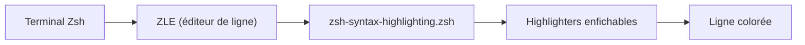

# zsh-users/zsh-syntax-highlighting

> Coloration syntaxique en direct, à la manière de Fish, pour la ligne de commande de Zsh.

## Le problème
Les erreurs de syntaxe dans une commande ne se voient qu'après l'avoir lancée.

## Ce que ça fait vraiment
Colore la commande pendant la saisie dans un terminal Zsh interactif, ce qui aide à la relire avant exécution. S'accroche à l'éditeur de ligne ZLE. Les règles sont portées par des « highlighters » enfichables et configurables.

## Comment c'est branché

Schéma simplifié d'après la fiche, sans diagramme fourni.

## Essayer
Les commandes d'installation ne figurent pas dans ce README : il renvoie à INSTALL.md. Seule consigne donnée : charger `zsh-syntax-highlighting.zsh` à la fin du `.zshrc`.

## Coût et pièges
Gratuit, licence BSD-3-Clause. Demande Zsh 4.3.11 ou plus ; la coloration pendant la recherche incrémentale d'historique exige Zsh 5.4. Il doit être chargé en dernier dans le `.zshrc`, après les autres widgets et hooks.

## Ce que ce n'est pas
Pas une autocomplétion ni un thème de prompt : il ne fait que colorer. Pas de canal d'annonce des versions (flux RSS des releases seulement).

## Alternatives
- Fish : le shell dont il imite la coloration.

## Pour toi
À adopter : si tu travailles dans Zsh, c'est un gain de confort immédiat pour relire des commandes de déploiement ou d'entraînement avant de les lancer.

