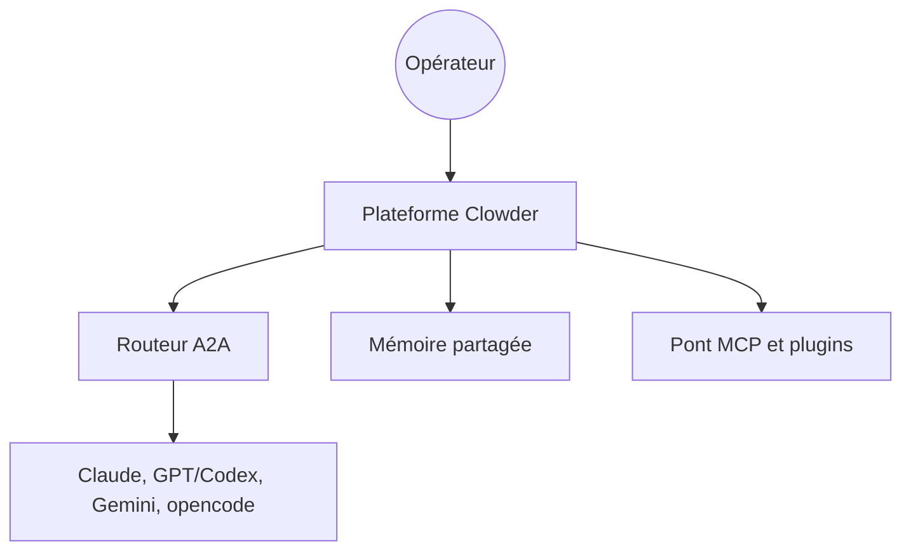

# zts212653/clowder-ai

> Platform that makes several AI agents (Claude, GPT, Gemini) collaborate like a team, for developers.

## The problem
Using several models separately forces you to copy context between them and coordinate everything by hand.

## What it actually does
A platform layer with persistent identity per agent, task routing, cross-review between models, agent-to-agent messaging by @mention, shared memory, skills, MCP tools and messaging adapters (Feishu, Telegram). The demos show conversation proposals, voting and scheduled tasks. A desktop installer exists for Windows and macOS.

## How it is wired


## Trying it
```bash
git clone https://github.com/zts212653/clowder-ai.git
cd clowder-ai
pnpm install
pnpm start
```
`pnpm start --quick` skips recompilation, `--daemon` runs in the background.

## Cost and gotchas
Node 20+ and pnpm 9+. Redis 7+ is optional (`--memory` to do without it). Models are billed through your own API keys.

## What it is not
Not a model nor a low-level framework: it is an orchestration platform. 376 open issues and a recent repository call for caution.

## Alternatives
- No alternative named in the README.

## For you
Worth watching: the idea of cross-review between models is useful, but the project is young and centered on a single maintainer; test before relying on it.
