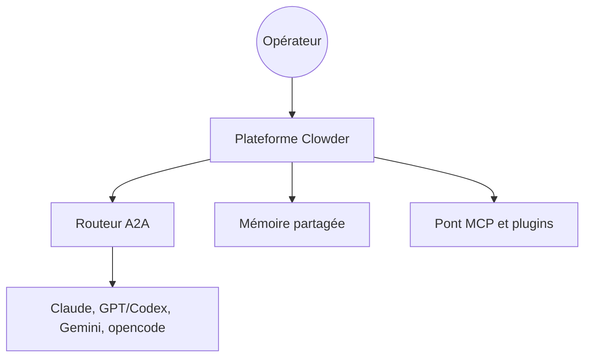

# zts212653/clowder-ai

> Plateforme qui fait collaborer plusieurs agents IA (Claude, GPT, Gemini) comme une équipe, pour développeurs.

## Le problème
Utiliser plusieurs modèles de façon séparée t'oblige à copier le contexte entre eux et à tout coordonner à la main.

## Ce que ça fait vraiment
Une couche de plateforme avec identité persistante par agent, routage de tâches, revue croisée entre modèles, messagerie agent à agent par @mention, mémoire partagée, skills, outils MCP et adaptateurs de messagerie (Feishu, Telegram). Les démonstrations montrent propositions de conversations, vote et tâches planifiées. Un installateur de bureau existe pour Windows et macOS.

## Comment c'est branché


## Essayer
```bash
git clone https://github.com/zts212653/clowder-ai.git
cd clowder-ai
pnpm install
pnpm start
```
`pnpm start --quick` saute la recompilation, `--daemon` tourne en arrière-plan.

## Coût et pièges
Node 20+ et pnpm 9+. Redis 7+ est optionnel (`--memory` pour s'en passer). Les modèles sont facturés via tes propres clés d'API.

## Ce que ce n'est pas
Pas un modèle ni un framework de bas niveau : c'est une plateforme d'orchestration. 376 issues ouvertes et un dépôt récent invitent à la prudence.

## Alternatives
- Aucune alternative nommée dans le README.

## Pour toi
À surveiller : l'idée de revue croisée entre modèles est utile, mais le projet est jeune et centré sur un seul mainteneur ; à tester avant de s'y fier.

