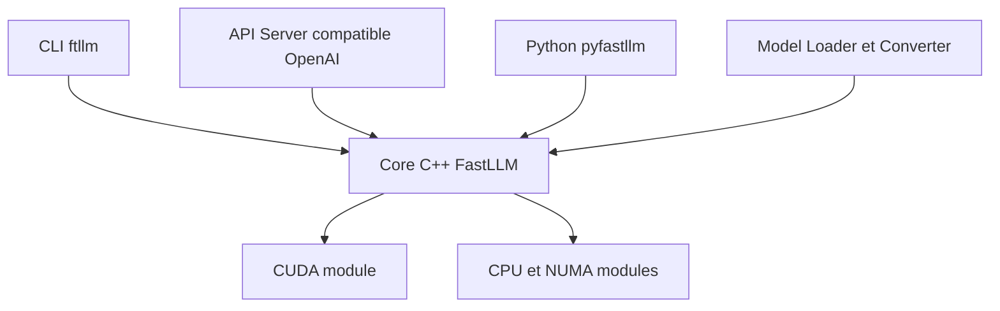

# ztxz16/fastllm

> C++ LLM inference engine without PyTorch, with an OpenAI- and Anthropic-compatible API, including hybrid GPU/CPU.

## The problem
Running large models (including MoE) on limited hardware requires distributing weights and caches across GPU, CPU and disk.

## What it actually does
`ftllm` automatically plans devices, memory, expert cache and context with `--auto`. It serves a Chat Completions, Responses and Messages API, a web interface and a browser launcher. Safetensors, FastLLM, AWQ and adapted GGUF formats. `--auto` only applies to Linux with NVIDIA CUDA and supported models.

## How it is wired
Provided diagram judged unreliable (generic explanation), reduced diagram based on the README.



## Trying it
```sh
python -m pip install -U ftllm
ftllm server Qwen/Qwen3-0.6B
ftllm run Qwen/Qwen3-0.6B
ftllm server /path/to/model --auto
```

## Cost and gotchas
An NVIDIA GPU is needed for the main path; AMD via ROCm, CPU-only by compilation. Large models demand a lot of VRAM and RAM. 360 open issues, README in Chinese.

## What it is not
Not a training framework. Support depends on the model and platform: the announced speeds vary with hardware and quantization.

## Alternatives
- llama.cpp and ik_llama.cpp: source of the GGUF formats and of the reused kernels.
- vLLM: cited for tool-call parsing.
- KTransformers: cited for MoE scheduling.

## For you
Worth watching: relevant for serving MoE models locally with little VRAM, to be compared with llama.cpp or vLLM on your hardware.
