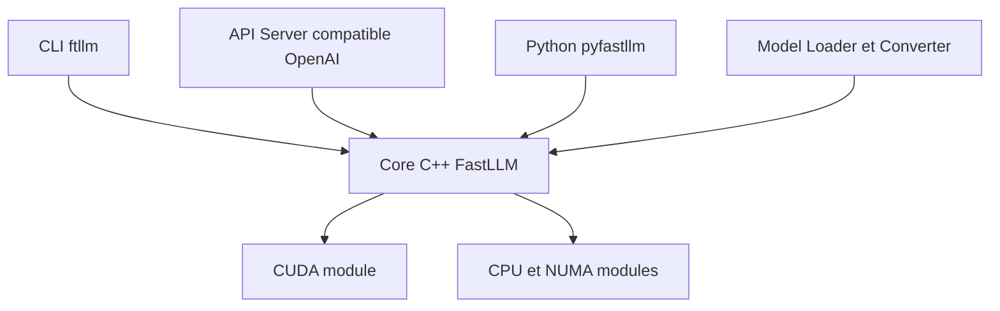

# ztxz16/fastllm

> Moteur d'inférence LLM en C++ sans PyTorch, avec API compatible OpenAI et Anthropic, y compris en hybride GPU/CPU.

## Le problème
Faire tourner de gros modèles (dont MoE) sur du matériel limité exige de répartir poids et caches entre GPU, CPU et disque.

## Ce que ça fait vraiment
`ftllm` planifie automatiquement appareils, mémoire, cache d'experts et contexte avec `--auto`. Il sert une API Chat Completions, Responses et Messages, une interface web et un lanceur navigateur. Formats Safetensors, FastLLM, AWQ et GGUF adaptés. `--auto` ne concerne que Linux avec CUDA NVIDIA et les modèles pris en charge.

## Comment c'est branché
Diagramme fourni jugé peu fiable (explication générique), schéma réduit d'après le README.



## Essayer
```sh
python -m pip install -U ftllm
ftllm server Qwen/Qwen3-0.6B
ftllm run Qwen/Qwen3-0.6B
ftllm server /path/to/model --auto
```

## Coût et pièges
Il faut un GPU NVIDIA pour le chemin principal ; AMD via ROCm, CPU seul par compilation. Les gros modèles réclament beaucoup de VRAM et de RAM. 360 issues ouvertes, README en chinois.

## Ce que ce n'est pas
Pas un framework d'entraînement. Le support dépend du modèle et de la plateforme : les vitesses annoncées varient selon matériel et quantification.

## Alternatives
- llama.cpp et ik_llama.cpp : source des formats GGUF et des noyaux réutilisés.
- vLLM : cité pour l'analyse des appels d'outils.
- KTransformers : cité pour l'ordonnancement MoE.

## Pour toi
À surveiller : pertinent pour servir des modèles MoE en local avec peu de VRAM, à comparer à llama.cpp ou vLLM sur ton matériel.

