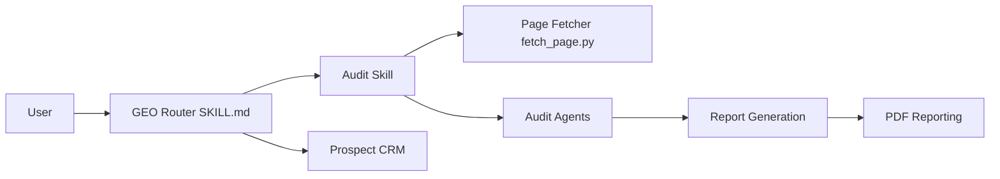

# zubair-trabzada/geo-seo-claude

> Claude Code skill for auditing SEO and visibility in AI search engines.

## The problem
Sites optimized for Google are not necessarily cited by ChatGPT, Perplexity or AI Overviews.

## What it actually does
Installs a `geo` skill and 13 sub-skills in `~/.claude/skills`, with 5 parallel sub-agents.
`/geo audit` fetches the site, launches the agents (AI visibility, platforms, technical, content, schema) and computes a weighted 0-100 score.
Python scripts: "citability" scoring, robots.txt analysis for AI crawlers, llms.txt generation, brand scan, PDF report (ReportLab).
A CRM module for prospects and commercial proposals stored in `~/.geo-prospects/`.

## How it is wired


## Trying it
```bash
git clone https://github.com/zubair-trabzada/geo-seo-claude.git
cd geo-seo-claude
./install.sh
```

## Cost and gotchas
Requires Claude Code (subscription or API key at your expense). The `curl | bash` installer modifies your Claude config. The "GEO market" figures in the README are unsourced.

## What it is not
Not a real measurement of citation by AIs: scoring heuristics. The README also serves as a funnel to a paid community.

## Alternatives
None named in the README.

## For you
Ignore: a marketing/agency tool, outside the data/MLOps scope; only the skill + sub-agents layout may serve as an architecture example.
