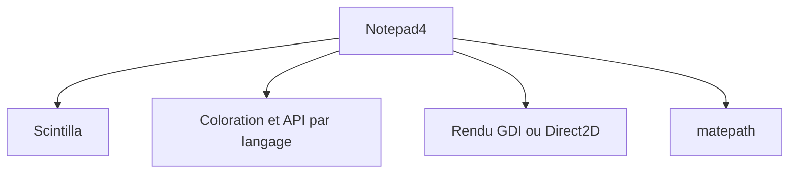

# zufuliu/notepad4

> Lightweight Windows text editor based on Scintilla, with syntax highlighting for a very large number of languages.

## The problem
Full code editors are heavy when you only need to quickly open and edit a text file.

## What it actually does
Notepad4 rewrites Notepad2 in modern C++ with Scintilla: highlighting, code folding and assisted input for a long list of languages (Python, R, SQL, Rust…), bookmarks, Boost regular expressions, Direct2D rendering. It adds number conversions and support for CJK and RTL. Companion plugin: matepath, a file browser.

## How it is wired
Simplified diagram based on the sheet, no diagram provided.



## Trying it
```bash
# Aucune commande : récupérer les builds de développement sur GitHub Actions ou AppVeyor, ou compiler (voir le wiki)
```

## Cost and gotchas
Free, Windows only. The binaries in the README are development builds; the license is not identified by GitHub.

## What it is not
Not an IDE: no debugger or project management. Not cross-platform.

## Alternatives
- Florian's Notepad2: the original it derives from.
- XhmikosR's Notepad2-mod: another variant mentioned.

## For you
Ignore: a simple Windows editor, unrelated to data, AI or MLOps workflows; your editor stack is probably already covered.
