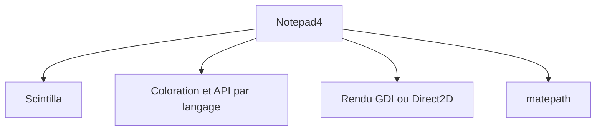

# zufuliu/notepad4

> Éditeur de texte Windows léger, basé sur Scintilla, avec coloration pour de très nombreux langages.

## Le problème
Les éditeurs de code complets sont lourds quand il faut seulement ouvrir et modifier rapidement un fichier texte.

## Ce que ça fait vraiment
Notepad4 réécrit Notepad2 en C++ moderne avec Scintilla : coloration, repli de code et saisie assistée pour une longue liste de langages (Python, R, SQL, Rust…), signets, expressions régulières Boost, rendu Direct2D. Il ajoute des conversions de nombres, de la prise en charge CJC et RTL. Plugin compagnon : matepath, navigateur de fichiers.

## Comment c'est branché
Schéma simplifié d'après la fiche, sans diagramme fourni.



## Essayer
```bash
# Aucune commande : récupérer les builds de développement sur GitHub Actions ou AppVeyor, ou compiler (voir le wiki)
```

## Coût et pièges
Gratuit, Windows seulement. Les binaires du README sont des builds de développement ; la licence n'est pas identifiée par GitHub.

## Ce que ce n'est pas
Pas un IDE : ni débogueur ni gestion de projets. Pas multiplateforme.

## Alternatives
- Notepad2 de Florian : l'original dont il dérive.
- Notepad2-mod de XhmikosR : autre variante citée.

## Pour toi
À ignorer : simple éditeur Windows, sans lien avec les workflows data, IA ou MLOps ; ta stack d'éditeur est probablement déjà couverte.

