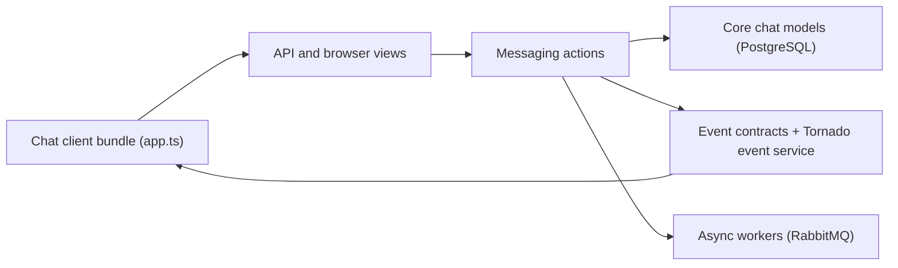

# zulip/zulip

> Open-source team messaging organized in topic threads, self-hostable or as a cloud offering.

## The problem
Team discussions drown in continuous streams; live conversation and asynchronous work have to be reconciled.

## What it actually does
Multi-organization Django server with a TypeScript web client. Messages are organized into channels and topics. A Tornado service handles real-time synchronization, RabbitMQ feeds workers (email, notifications, link previews, outgoing webhooks). Incoming webhooks normalize third-party services. Optional modules handle Stripe billing and statistics. Production: PostgreSQL, Redis/Memcached, Nginx, Supervisor, Puppet.

## How it is wired

## Trying it
No command in the README; it points to the self-hosting guide (Ubuntu/Debian, Docker) and to the development channel for trying it without an account.

## Cost and gotchas
Self-hosted: a server with PostgreSQL, RabbitMQ and caches; a Zulip Cloud offering is available, free for some organizations. 2,009 open issues.

## What it is not
Not a data tool. The cloud billing components are part of the repository but are optional.

## Alternatives
- No alternative named in the README.

## For you
Worth watching: relevant only if your team wants structured threaded chat, to be hosted on non-trivial infrastructure.
