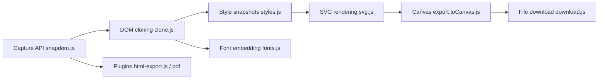

# zumerlab/snapdom

> Library that captures the rendered DOM as an image, canvas, HTML or PDF, for front-end developers.

## The problem
Exporting a page fragment (card, chart, invoice) with its styles, fonts and images means hacking around with canvas or server-side screenshots.

## What it actually does
Clones a DOM subtree, freezes styles and fonts, then renders to SVG by default (or, experimentally, via html-in-canvas). Core outputs: PNG, JPG, WebP, SVG, canvas, Blob, download. Plugins add standalone HTML, text/JSON context, a map for visual agents, PDF, GIF, video and vector export. Everything runs in the page, with no core dependency. v3 reuses unchanged captures.

## How it is wired


## Trying it
```bash
npm i @zumer/snapdom@latest @zumer/snapdom-plugins@latest
```
```js
import { snapdom } from '@zumer/snapdom';
const image = await snapdom.toPng(document.querySelector('#card'));
```

## Cost and gotchas
Free. A browser is required: no Node alone. Cross-origin resources need CORS or a proxy. `fromString()` executes the HTML you give it: sanitize it first. A predicate in `filter` or `exclude` disables memoization.

## What it is not
Not a server-side rendering engine nor a screenshot client for arbitrary pages. No CommonJS build. The html-in-canvas engine is experimental and needs a special build. Migrating from v2 to v3 breaks several options.

## Alternatives
No alternative named in the README.

## For you
Adopt if your interface (dashboards, reports) must export images or PDFs client-side: good DOM coverage and plugins planned for agents.
