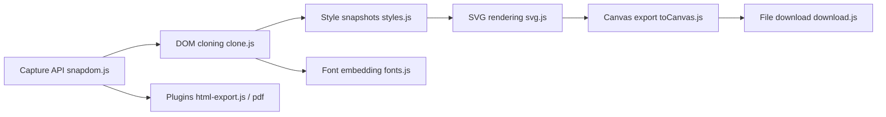

# zumerlab/snapdom

> Bibliothèque de capture du DOM rendu en image, canvas, HTML ou PDF, pour développeurs front.

## Le problème
Exporter un fragment de page (carte, graphique, facture) avec ses styles, polices et images demande de bricoler du canvas ou des captures serveur.

## Ce que ça fait vraiment
Clone un sous-arbre DOM, fige les styles et polices, puis rend en SVG par défaut (ou, en expérimental, via html-in-canvas). Sorties du cœur : PNG, JPG, WebP, SVG, canvas, Blob, téléchargement. Des plugins ajoutent HTML autonome, contexte texte/JSON, carte pour agents visuels, PDF, GIF, vidéo et export vectoriel. Tout tourne dans la page, sans dépendance de cœur. La v3 réutilise les captures inchangées.

## Comment c'est branché


## Essayer
```bash
npm i @zumer/snapdom@latest @zumer/snapdom-plugins@latest
```
```js
import { snapdom } from '@zumer/snapdom';
const image = await snapdom.toPng(document.querySelector('#card'));
```

## Coût et pièges
Gratuit. Il faut un navigateur : pas de Node seul. Les ressources cross-origin demandent CORS ou un proxy. `fromString()` exécute le HTML fourni : nettoie-le avant. Un prédicat dans `filter` ou `exclude` désactive la mémoïsation.

## Ce que ce n'est pas
Pas un moteur de rendu serveur ni un client de captures d'écran de pages arbitraires. Pas de build CommonJS. Le moteur html-in-canvas est expérimental et demande un build spécial. La migration v2 vers v3 casse plusieurs options.

## Alternatives
Aucune alternative nommée dans le README.

## Pour toi
À adopter si ton interface (dashboards, rapports) doit exporter des images ou des PDF côté client : bonne couverture du DOM et plugins prévus pour les agents.

