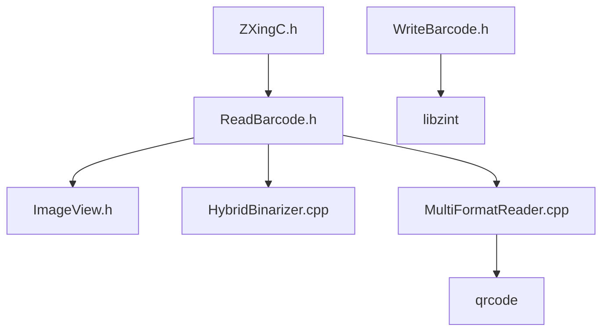

# zxing-cpp/zxing-cpp

> C++ library to read and write barcodes and QR codes, with many bindings.

## The problem
Extract the text of a QR code or barcode from an image, or generate one, without an external service.

## What it actually does
Reads linear formats, QR, Data Matrix, Aztec, PDF417 and MaxiCode from in-memory pixels, and writes to image, SVG or text (zint backend since 3.0). Bindings: Python, Rust, Go, .NET, Android, iOS, WebAssembly, among others.

## How it is wired


## Trying it
```bash
git clone https://github.com/zxing-cpp/zxing-cpp.git --recursive --depth 1
cmake -S zxing-cpp -B zxing-cpp/build -DCMAKE_BUILD_TYPE=Release
cmake --build zxing-cpp/build --parallel --config Release
```

## Cost and gotchas
CMake 3.21 and a C++20 compiler. You have to load the image yourself with another library.

## What it is not
Not an OCR nor an object detector: it decodes barcode symbologies. The web demos are not guaranteed to be up to date.

## Alternatives
- ZXing Java: the original it is ported from, less performant.

## For you
Watch: handy if a vision pipeline must read QR codes/barcodes, via the Python binding.
