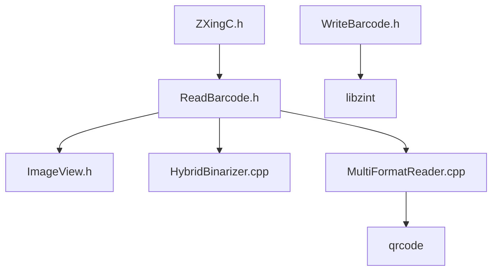

# zxing-cpp/zxing-cpp

> Bibliothèque C++ pour lire et écrire codes-barres et QR codes, avec nombreux bindings.

## Le problème
Extraire le texte d'un QR code ou d'un code-barres depuis une image, ou en générer un, sans service externe.

## Ce que ça fait vraiment
Lit les formats linéaires, QR, Data Matrix, Aztec, PDF417 et MaxiCode à partir de pixels en mémoire, et écrit en image, SVG ou texte (backend zint depuis la 3.0). Bindings : Python, Rust, Go, .NET, Android, iOS, WebAssembly, entre autres.

## Comment c'est branché


## Essayer
```bash
git clone https://github.com/zxing-cpp/zxing-cpp.git --recursive --depth 1
cmake -S zxing-cpp -B zxing-cpp/build -DCMAKE_BUILD_TYPE=Release
cmake --build zxing-cpp/build --parallel --config Release
```

## Coût et pièges
CMake 3.21 et un compilateur C++20. Il faut charger l'image soi-même avec une autre bibliothèque.

## Ce que ce n'est pas
Pas un OCR ni un détecteur d'objets : il décode des symbologies de codes-barres. Les démos web ne sont pas garanties à jour.

## Alternatives
- ZXing Java : l'original dont il est porté, moins performant.

## Pour toi
Surveiller : pratique si un pipeline de vision doit lire des QR/codes-barres, via le binding Python.

