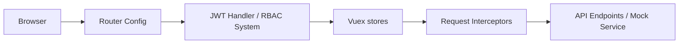

# zxwk1998/vue-admin-better

> Vue 2 + Element UI admin dashboard template, with roles and JWT.

## The problem
Starting a web back-office means redoing layout, routing, authentication and permission management.

## What it actually does
Front-end template (40+ pages): RBAC with JWT, routes filtered on the front end or driven by the back end, automatic mock, 50+ global options, wrapped Axios, RSA encryption of the login, multiple themes and layouts, error log. This version is Vue 2 / Element UI; separate repositories exist for Vue 3. README in Chinese, with commercial offers (Admin Pro, Admin Plus).

## How it is wired


## Trying it
```bash
git clone -b master https://github.com/zxwk1998/vue-admin-better.git
pnpm i --registry=http://mirrors.cloud.tencent.com/npm/
npm run serve:rspack
```

## Cost and gotchas
Free in the open version (MIT, commercial use allowed). Vue 2 is end-of-life; paid Pro versions are separate.

## What it is not
Not a data visualization framework. No back end provided (mock only).

## Alternatives
vue3-admin-better and vue-admin-arco, repositories by the same author cited in the README.

## For you
A Vue 2 front-end template brings nothing to a data/AI profile: ignore.
