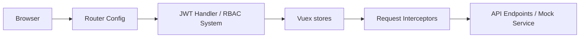

# zxwk1998/vue-admin-better

> Gabarit de tableau de bord d'administration Vue 2 + Element UI, avec rôles et JWT.

## Le problème
Démarrer un back-office web impose de refaire layout, routage, authentification et gestion des permissions.

## Ce que ça fait vraiment
Gabarit front (40+ pages) : RBAC avec JWT, routes filtrées côté front ou piloté par le back, mock automatique, 50+ options globales, Axios encapsulé, chiffrement RSA du login, multi-thèmes et layouts, journal d'erreurs. Cette version est Vue 2 / Element UI ; des dépôts séparés existent pour Vue 3. README en chinois, avec offres commerciales (Admin Pro, Admin Plus).

## Comment c'est branché


## Essayer
```bash
git clone -b master https://github.com/zxwk1998/vue-admin-better.git
pnpm i --registry=http://mirrors.cloud.tencent.com/npm/
npm run serve:rspack
```

## Coût et pièges
Gratuit en version ouverte (MIT, usage commercial permis). Vue 2 est en fin de vie ; versions Pro payantes à part.

## Ce que ce n'est pas
Pas un framework de visualisation de données. Pas de back-end fourni (mock seulement).

## Alternatives
vue3-admin-better et vue-admin-arco, dépôts du même auteur cités dans le README.

## Pour toi
Un gabarit front Vue 2 n'apporte rien à un profil data/IA : à ignorer.

