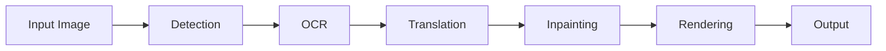

# zyddnys/manga-image-translator

> Automatic translation of the text inside manga images: detection, OCR, translation, inpainting, rendering.

## The problem
Comics and images shared online are almost never professionally translated.

## What it actually does
Pipeline: text detection (default, ctd, craft, paddle), OCR (32px, 48px, mocr), translation, erasing by inpainting (lama, sd), typographic rendering.
Online translators (DeepL, OpenAI, Gemini, DeepSeek, Groq…) or offline ones (NLLB, M2M100, Sugoi, Qwen2).
Batch CLI modes, web server, FastAPI API, WebSocket; detailed JSON config, glossaries, pre/post dictionaries.
Export to PNG/JPG or XCF/PSD/PDF via GIMP.

## How it is wired
The provided graph has no readable component; diagram based on the explanation:


## Trying it
```bash
git clone https://github.com/zyddnys/manga-image-translator.git
python -m venv venv
source venv/bin/activate
pip install -r requirements.txt
python -m manga_translator local -v -i <path>
```

## Cost and gotchas
Cloud translators = API keys at your expense. Docker image ~15 GB; models downloaded on first launch. GPU recommended.

## What it is not
"Early stage" according to its authors; English rendering quality is imperfect (text areas, not speech bubbles). Not a video tool.

## Alternatives
- Manga Image Translator Rust: compiled binary that is easier to install (CLI only).

## For you
To ignore as a tool, but the multi-backend detection/OCR/inpainting pipeline is a good case study in orchestrating vision models.
