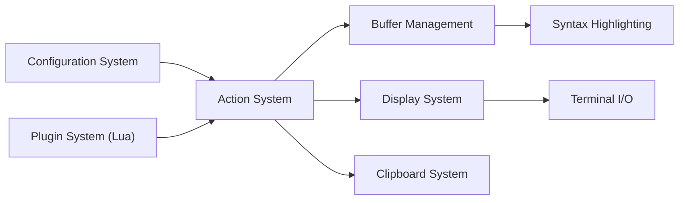

# zyedidia/micro

> Simple and intuitive terminal text editor, shipped as a single static binary.

## The problem
Editing a file over SSH forces a choice between nano, which is minimal, and vim, which is hard to pick up.

## What it actually does
Terminal editor with common shortcuts (Ctrl-s, Ctrl-c, Ctrl-v), multiple cursors, tabs and splits, good mouse support, syntax highlighting for more than 130 languages, persistent undo and macros. A Lua plugin system, with a built-in manager, extends it. The system clipboard requires xclip, xsel or wl-clipboard on Linux.

## How it is wired


## Trying it
```bash
brew install micro
snap install micro --classic
curl https://getmic.ro | bash
micro path/to/file.txt
ip a | micro
```

## Cost and gotchas
Free. The curl | bash script is third-party. On Mac, shortcuts use Ctrl and Alt: the terminal must pass Alt through. Cygwin, Mingw and Plan9 are not supported.

## What it is not
Not an IDE: no built-in debugging or project management. This repository is the same project as micro-editor/micro (identical README): catalog duplicate.

## Alternatives
- nano: of which micro aims to be the successor.

## For you
To adopt: handy for editing configuration files on remote servers or containers, with no dependencies.
