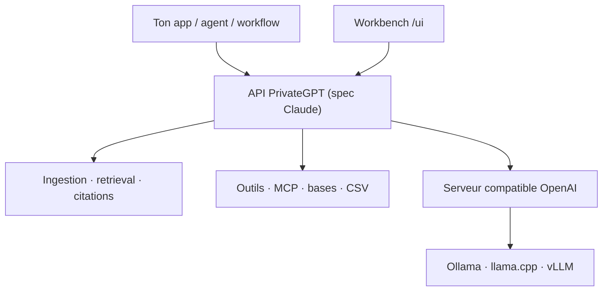

# zylon-ai/private-gpt

> Open-source API layer that turns local models into AI applications.

## The problem
Running a model locally is only the first step: messages, document ingestion, citations, tools and MCP still have to be recoded for every project.

## What it actually does
Exposes an API modeled on the Claude API on top of any OpenAI-compatible inference server (`OPENAI_API_BASE`): messages API with streaming, asynchronous processing and token counting; file and artifact ingestion; retrieval with citations and agentic RAG; built-in tools (web search, fetch, code execution); custom tools and MCP connectors; structured access to databases and CSVs; embeddings. A web workbench at `/ui` is used for testing and demos.

## How it is wired


## Trying it
```bash
brew tap zylon-ai/tap && brew install private-gpt
ollama pull qwen3.5:35b
OPENAI_API_BASE=http://localhost:<llm-port>/v1 private-gpt serve
```

## Cost and gotchas
Free and open source. PrivateGPT **does not run** a model: you need an inference server alongside, hence the corresponding RAM or GPU (the example model weighs ~24 GB). Prompt caching and OAuth/organizations are not supported.

## What it is not
The UI is a demonstrator, not the product: the API is the product. It is not a competitor to Ollama or vLLM but the layer above them. Onyx and Open WebUI are finished applications; PrivateGPT is the underlying API. Enterprise support, Kubernetes deployment, RBAC and SIEM logs belong to Zylon, the commercial offering.

## Alternatives
- Ollama, LM Studio, LocalAI, vLLM, llama.cpp: the inference layer, to be used *with* it, not instead of it.
- Onyx, Open WebUI: if you want a finished application rather than an API.

## For you
Adopt if you are building an AI application on local models: it saves you from rewriting ingestion, citations and tools.
