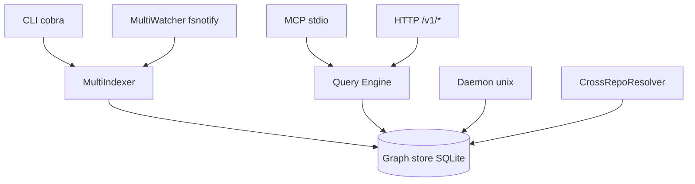

# zzet/gortex

> Code indexing engine that exposes a symbol graph to coding agents via MCP.

## The problem
An agent that reads whole files to answer "what breaks if I change this" burns context for nothing.
Multiplying per-language analysis tools produces answers that are inconsistent from one file to the next.

## What it actually does
Parses 257 languages via tree-sitter, with reinforced resolution on about fifteen compiled languages, and builds a persistent graph of functions, classes, call chains, HTTP routes and cross-service contracts.
Exposes this graph over MCP (more than 100 tools advertised, configurable) to 19 coding agents detected automatically at install time.
Detects contracts between repositories — HTTP, gRPC, GraphQL, Kafka/NATS topics, WebSocket, environment variables, OpenAPI, Temporal workflows — normalized into canonical identifiers.
A single daemon serves all IDE windows, with an on-disk SQLite store and fsnotify tracking.

## How it is wired


## Trying it
```bash
curl -fsSL https://get.gortex.dev | sh
gortex install
gortex daemon start --detach
gortex track ~/projects/myapp
cd ~/projects/myapp && gortex init
```

## Cost and gotchas
Indexing large repositories costs memory: a measured peak of 5.07 GB on `torvalds/linux`, 3 minutes of indexing.
Building from source requires Go 1.26+ and CGO. Telemetry is disabled by default and honors `DO_NOT_TRACK`.

## What it is not
Not a proven product: the advertised breadth (257 languages, 19 agents, 9 LLM providers) goes well beyond what a README lets you verify.
The "50× fewer tokens" figure is a measurement by the repository itself, not an independent result.
The README alternately claims "175 MCP tools", "100+" and "20 agent integrations": the counters do not agree.

## Alternatives
No alternative named in the README.

## For you
Worth a look if you spend your day in a coding agent on a monorepo; do not put it in production until the license is declared.
